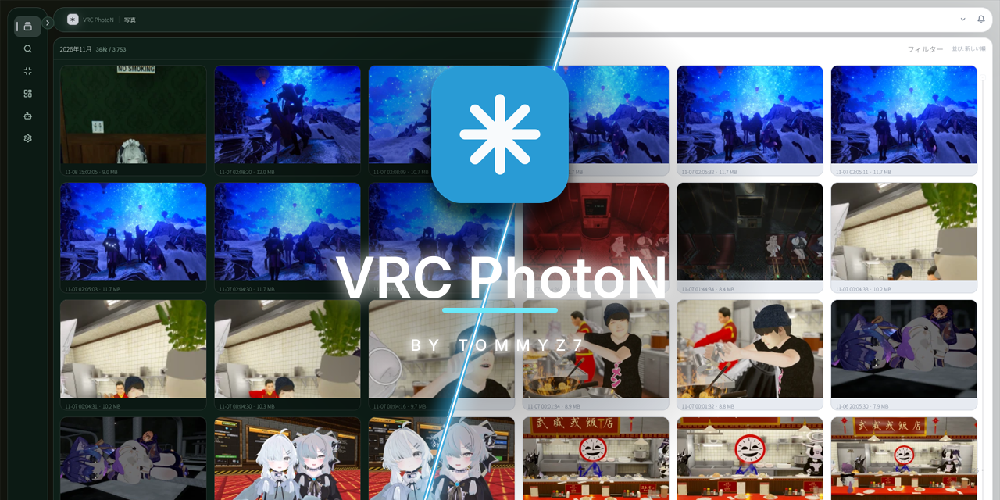

[English](README.md) | **日本語**

<p align="center">
  
</p>

<p align="center">
  <a href="https://github.com/TommyZ-7/vrc-photon/releases"></a>
  <a href="LICENSE"></a>
  
  
</p>

VRChatの写真を、撮ったときのワールド・一緒にいたプレイヤー・日時とあわせて管理するデスクトップアプリです。

VRChatのスクリーンショットは、ファイル名だけでは中身が分かりません。VRC PhotoNは写真フォルダを監視し、VRChatの出力ログとPNGのXMPメタデータから「いつ、どこで、誰と撮ったか」を読み取って写真に紐付けます。ライブラリ・サムネイル・設定は手元のPCに保存します。ネットワーク通信は、アップデート確認、任意で有効化するDiscord送信とVRChat APIのワールド名解決、利用者が開始したAIモデルのダウンロードに限られます。


<!-- TODO: 実画面のスクリーンショットを docs/images/main.png に置き、下の行を有効化する

-->

## できること

**探す**

- 時系列とセッションの2つの表示モードがあります。セッション表示は、ログに残ったワールド滞在ごとに写真をまとめます。
- 仮想スクロール、年レール、ページ単位の読み込みで、大量の写真でも扱いやすくしています。
- フルスクリーンビューアはズームとパンに対応しています。同じBLAKE3ハッシュの写真には重複バッジを出します。
- ワールド、プレイヤー、手動タグ、適用済みAIタグ、AIの人数、日時、お気に入りで検索できます。入力中は候補も表示します。
- 写真ごとにワールドと同接プレイヤーをログから自動で紐付けます。ログが無い写真はXMPメタデータで補います。未解決のワールド名は、有効化した場合だけVRChat APIで解決します。

**整理する**

- タグ、メモ、お気に入り、複数選択に対応しています。右クリックメニューから圧縮、Discord送信、タグ編集、パスのコピー、フォルダを開く、ゴミ箱への移動ができます。
- ファイルやフォルダをコピーまたは移動で取り込めます。取り込み時に元のフォルダ階層を維持することもできます。
- 削除はOSのゴミ箱へ移動します。削除キューは、実行中の圧縮・送信・AIタグ付けが終わるまで待ちます。

**圧縮する**

- JPEG / WebP / AVIF / JPEG XL への変換、リサイズ、形式が対応していればロスレス出力ができます。
- プロファイルを作っておけば、索引時の自動圧縮、単発・一括圧縮、クリップボード出力、Discord送信用の変換に同じ設定を使えます。
- 元画像を残すか、検証後に置き換える（元画像はOSのゴミ箱へ送る）かを実行ごとに選べます。

**連携する**

- Discord Webhookへ写真を送れます（任意設定）。手動送信と自動送信、送信履歴、再試行に対応しています。
- 同梱の読み取り専用MCPサーバーを使うと、MCPクライアントからライブラリ検索、写真の詳細・画像取得、ワールド一覧・統計の取得ができます。
- AIタグ付け（有償プラグイン・別配布）は、人物の有無、人数、屋内・屋外、雰囲気・シーンタグをローカル推論で付けます。導入方法と動作要件は [AIタグ付けのドキュメント](docs/ai-tagging/README.md) を参照してください。
- UIは日本語と英語に対応しています。テーマの色変更、トレイ常駐、自動起動、署名付き自動アップデートも利用できます。

## インストール

[Releases](https://github.com/TommyZ-7/vrc-photon/releases) から、使っている環境のファイルをダウンロードしてください。

| 環境 | ファイル |
|---|---|
| Windows | `vrc-photon_<バージョン>_x64-setup.exe` |
| Debian / Ubuntu | `vrc-photon_<バージョン>_amd64.deb` |
| Arch系 | `vrc-photon-<バージョン>-1-x86_64.pkg.tar.zst` |
| その他のLinux | `vrc-photon_<バージョン>_x86_64.AppImage`、または `.tar.gz` |

写真フォルダとログフォルダは初回起動時に自動で検出されます。検出できない環境では、デーモンの起動時に `--photo-dir` と `--log-dir` で指定してください。

## 仕組み

UIとバックグラウンドのデーモンで構成されます。デーモンがフォルダ監視、ログ取り込み、写真の紐付け、圧縮、サムネイル生成を担当し、UIが表示と編集を担当します。両者は同じSQLiteデータベース（`library.db`）を共有し、即時の操作にはローカルIPCを使います。MCPサーバーは別プロセスの読み取り専用サーバーで、同じIPC経由でデーモンに接続します。

```text
crates/
  core/         データベース、写真索引、ログ/XMP解析、紐付け、圧縮、サムネイル
  daemon/       監視、ログ取り込み、ワーカー、トレイ、自動起動、IPCサーバー
  ui/           GPUI製のUI、IPCクライアント
  mcp/          読み取り専用のstdio MCPサーバー
  ipc/          ローカルIPCのプロトコルとトランスポート
  ai-protocol/  AIプラグインのプロトコル、カタログ型、JSONLフレーミング
  ai-host/      プラグイン検証、モデル管理、sidecarクライアント
  update/       署名付き更新確認、ダウンロード、適用ジョブ、ヘルパー
  signing/      共通のminisign検証
  i18n/         日本語 / 英語のカタログ
  release-tool/ リリース用マニフェストの署名・検証
```

詳しい構成は [docs/architecture.md](docs/architecture.md) にあります。

## ソースからビルド

前提はRust stableのほか、プラットフォームごとにいくつか要ります（Linuxは `libxkbcommon-dev`、`libwayland-dev`、`libvulkan-dev` など。JPEG XLのビルドには CMake / Ninja / C++コンパイラ）。詳細は [docs/development.md](docs/development.md) を参照してください。

```bash
cargo build --workspace
```

サンプルデータでUIだけ試す場合は `cargo run -p vrc-photon-ui -- --demo` が使えます。

## ドキュメント

ドキュメントは日本語で書かれています。

- [ドキュメント索引](docs/README.md)
- [機能仕様](docs/features.md)
- [アーキテクチャ](docs/architecture.md)
- [データモデル](docs/data-model.md)
- [UI仕様](docs/ui.md)
- [開発環境の構築](docs/development.md)
- [テスト](docs/testing.md)
- [リリースとパッケージ](docs/release.md)
- [AIタグ付けプラグイン](docs/ai-tagging/README.md)
- [MCPサーバー](docs/mcp.md)
- [コントリビューション](CONTRIBUTING.md)

## ライセンス

本体は GPL-3.0-or-later です。AIタグ付けプラグインは、本体とは別のライセンスで提供しています。
