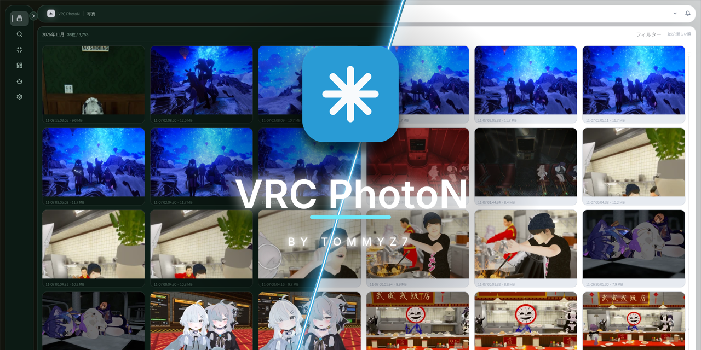

**English** | [日本語](README.ja.md)

<p align="center">
  
</p>

# VRC PhotoN

<p align="center">
  <a href="https://github.com/TommyZ-7/vrc-photon/releases"></a>
  <a href="LICENSE"></a>
  
  
</p>

A desktop app for organizing your VRChat photos together with the world they were taken in, the players you were with, and when they were taken.

VRChat screenshots tell you nothing from their file names alone. VRC PhotoN watches your photo folder and reads "when, where, and who with" from VRChat's output logs and the PNG XMP metadata, and links that context to each photo. All records are stored in a local SQLite database; your photos and logs are never sent anywhere.

<p align="center">
  
</p>

<!-- TODO: Place a screenshot of the actual app at docs/images/main.png and enable the line below

-->

## Features

**Find**

- The photo grid uses virtual scrolling, so even large libraries scroll in one go
- Search by world name, player name, tags, date and time, and favorites
- Each photo is automatically linked to its world and the players present from the logs. Photos without logs fall back to XMP metadata

**Compress**

- Convert to JPEG / WebP / AVIF / JPEG XL, with resizing
- Create profiles once, and the same settings drive both automatic compression on import and batch compression of selected photos
- For each run, choose whether to keep the originals or replace them (sent to the OS trash)

**And more**

- The photo details view shows the preview, world, instance, players present, tags, notes, and compression history, and lets you edit them
- Send photos to a Discord webhook (optional, off by default)
- System tray residency and autostart, with signed automatic updates
- The UI is available in Japanese and English

**AI tagging (paid plugin)**

A separately sold plugin tags photos by the presence and number of people, the location, and the atmosphere, all inferred locally. Inference runs entirely on your own PC. See the [AI tagging documentation](docs/ai-tagging/README.md) (in Japanese) for installation and system requirements.

## Installation

Download the file for your platform from [Releases](https://github.com/TommyZ-7/vrc-photon/releases).

| Platform | File |
|---|---|
| Windows | `vrc-photon_<version>_x64-setup.exe` |
| Debian / Ubuntu | `vrc-photon_<version>_amd64.deb` |
| Arch-based | `vrc-photon-<version>-1-x86_64.pkg.tar.zst` |
| Other Linux | `vrc-photon_<version>_x86_64.AppImage`, or `.tar.gz` |

The photo folder and the log folder are detected automatically on first launch. On systems where detection fails, specify them when starting the daemon with `--photo-dir` and `--log-dir`.

## How it works

Two processes: a UI and a daemon. The daemon watches folders, parses logs, compresses, and generates thumbnails; the UI handles display and interaction. Both share the same SQLite database (`library.db`) and use local IPC for immediate operations.

```text
crates/
  core/     Database, photo indexing, log parsing, XMP, linking, compression, thumbnails
  ipc/      Local IPC protocol and transport
  daemon/   Watching, automatic compression, tray, autostart, IPC server
  ui/       GPUI-based UI, IPC client
```

See [docs/architecture.md](docs/architecture.md) for the full picture.

## Building from source

You need Rust stable plus a few platform-specific packages (on Linux, `libxkbcommon-dev`, `libwayland-dev`, `libvulkan-dev`, and so on; building JPEG XL requires CMake / Ninja / a C++ compiler). See [docs/development.md](docs/development.md) for details.

```bash
cargo build -p vrc-photon-ui
cargo build -p vrc-photon-daemon
```

To try just the UI with sample data, use `cargo run -p vrc-photon-ui -- --demo`.

## Documentation

Documentation is currently written in Japanese.

- [Documentation index](docs/README.md)
- [Architecture](docs/architecture.md)
- [Development setup](docs/development.md)
- [Release and packaging](docs/release.md)
- [AI tagging plugin](docs/ai-tagging/README.md)
- [Roadmap](docs/roadmap.md)
- [Contributing](CONTRIBUTING.md)

## License

The app itself is GPL-3.0-or-later. The AI tagging plugin is provided under a separate license.
